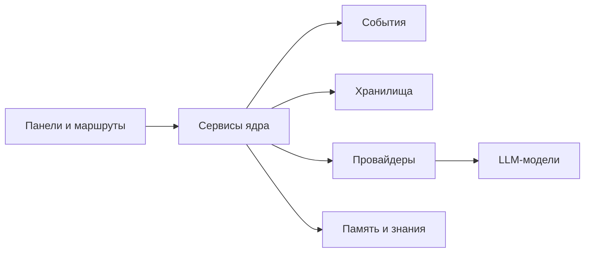

<!-- АВТОСГЕНЕРАЦИЯ: файл создан scripts/gen-wiki-docs.mjs из корпуса Wiki (src/components/WikiPanel). Не редактировать вручную. -->

# Возможности и сценарии

> Раздел: **Руководство** · Статус: verified · Теги: возможности, сценарии, руководства, ограничения, диагностика

Источники: `src/route-registry-core.ts`, `src/route-registry-system.ts`, `src/route-registry-content.ts`, `scripts/gen-wiki-capabilities.mjs`

# Возможности и сценарии

> Автосгенерировано `scripts/gen-wiki-capabilities.mjs` из реестров маршрутов (`route-registry-*.ts`) и навигации. Не редактировать вручную.

Что можно делать в SuperAgents OS и где об этом читать. Обзор возможностей —
[Возможности ОС](./capabilities.md); справочник по панелям — [Как пользоваться панелями](./panels-guide.md) и [Каталог панелей: раздел → маршрут → компонент → статья](./panels-catalog.md).

## Области возможностей

Навигация задаёт пользовательские области; в каждой — свои панели:

| Область | Панелей | Примеры |
| --- | --- | --- |
| Панель | 28 | [Панель: Обзор (Dashboard)](./panel-dashboard.md), [Панель: Помощник проекта](./panel-assistant.md), [Панель: Провайдеры и ключи](./panel-providers.md) |
| Бюджет AI | 7 | [Панели: Аналитика, затраты и ключи](./panel-analytics.md), [Панель: Бюджет и затраты](./panel-budget.md), [Панель: Бюджеты компании (gateway)](./panel-costs.md) |
| Чат | 4 | [Панель: Чат](./panel-chat.md), [Панели: Сессии и привязки](./panel-sessions.md), [Панель: Закладки](./panel-bookmarks.md) |
| Дебаты | 17 | [Дебаты: режимы и механика](./debates.md), [Панель: Живые дебаты](./panel-debate-live.md), [Панель: Шаблоны дебатов](./panel-debate-templates.md) |
| Стратегия и анализ | 4 | [Панели: Метрики-анализаторы](./panel-eval-extra.md), [Панели: Планирование и миссии](./panel-planning.md) |
| Техники | 84 | [Инструменты анализа дебатов](./panel-debate-toolkit.md), [Панели: Метрики-анализаторы](./panel-eval-extra.md), [Панели: Связи, происхождение, очередь](./panel-provenance-junctions.md) |
| Агенты | 15 | [Агенты: устройство и управление](./agents.md), [Панель: Роли и консорциумы](./panel-roles.md), [Панель: SRE-агент](./panel-sre.md) |
| Диагностика | 20 | [Панель: Наблюдаемость (логи, трейсы, здоровье)](./panel-observability.md), [Знания и память](./memory.md), [Панель: Карта давления](./panel-pressure.md) |
| Вики | 3 | [Панель: Wiki](./panel-wiki.md), Вики-мозг, Карта архитектуры |
| Флот | 12 | [Панель: Флот (Fleet Console)](./panel-fleet.md), [Панели: Компании и корпоративный gateway](./panel-gateway.md), [Панель: Задачи агентов](./panel-agent-tasks.md) |
| Google AI | 4 | [Панели: Провайдерские дополнения](./panel-providers-extra.md), [Панели: Интеграции (MCP, коннекторы, навыки, инструменты, вебхуки)](./panel-integrations.md), [Панели: Исследование (расширенное и Gemini)](./panel-research-extra.md) |
| Исследования | 8 | [Панель: Исследовательский движок](./panel-research.md), Research Cockpit, [Панели: Исследования системы дебатов](./panel-debate-research.md) |
| Интеграции | 1 | [Панель: Потоки (workflows)](./panel-workflows.md) |
| Рандомс | 2 | [Панели: Файлы, редакторы, обучение, голос](./panel-files-editors.md), [Панели: Агенты — маркетплейс и протокол](./panel-agents-market.md) |
| AI провайдеры и ключи | 13 | [Панель: Пул ключей провайдеров](./panel-pools.md), [Панель: Группы ключей](./panel-groups.md), [Панель: Заметки к ключам](./panel-key-notes.md) |
| Системные сервисы | 11 | [Панели: Интеграции (MCP, коннекторы, навыки, инструменты, вебхуки)](./panel-integrations.md), [Панели: Инфраструктура и платформа](./panel-infra-meta.md), [Панели: Симуляция и контрфакты](./panel-simulation.md) |
| Безопасность и правила | 11 | [Панель: Настройки](./panel-settings.md), [Панель: Governance и безопасность](./panel-governance.md), [Панели: История, аудит, версии, деплой](./panel-history-audit.md) |
| Системная память | 3 | [Панель: Дворец памяти](./panel-memory-palace.md), [Панели: Федеративная память и перенос](./panel-memory-extra.md) |
| Лаборатория | 8 | [Панель: Датасеты оценки](./panel-eval.md), [Панели: Исследования системы дебатов](./panel-debate-research.md), [Панель: Песочница сравнения моделей](./panel-playground.md) |
| Остальное | 13 | [Панели: Файлы, редакторы, обучение, голос](./panel-files-editors.md), [Панель: Библиотека промптов](./panel-prompt-library.md), [Панели: История, аудит, версии, деплой](./panel-history-audit.md) |

Всего панелей в навигации: **268**.

## Сквозные сценарии

Пользовательские пути «действие → результат» собраны в справочниках:

- [USER ACTION → RESULT](https://github.com/egilyad/ai-os-new/blob/main/docs/reference/USER_ACTION_MAP.md) — 5 канонов, карта без кода.
- [Карта пользовательского управления](https://github.com/egilyad/ai-os-new/blob/main/docs/reference/USER_CONTROL_MAP.md) — сервисы → понятная OS.
- [CAPABILITY MATRIX](https://github.com/egilyad/ai-os-new/blob/main/docs/reference/CAPABILITY_MATRIX.md) — матрица возможностей (статически проверенная).

## Руководства и примеры

- Пошаговый обзор панелей — [Как пользоваться панелями](./panels-guide.md); полный каталог — [Каталог панелей: раздел → маршрут → компонент → статья](./panels-catalog.md).
- Рецепты типовых задач — [Рецепты: типовые задачи](./dev-cookbook.md); вход для разработчика — [Разработчикам: структура и ворота](./for-developers.md).
- Как всё устроено внутри — [Архитектура и связи](./architecture.md), [Карта системы](./dev-system-map.md).

## Визуальные материалы

В вики 7 диаграмм Mermaid. Ниже — карта слоёв системы:

## Ограничения

- Технические панели (техники) — их 84; это шаблонные эксперименты, не все несут данные.
- Часть провайдеров требует собственных API-ключей; без ключа их возможности недоступны.
- Реестр архитектурных решений (ADR) и каталог внешних библиотек пока не выделены (см. [Карта системы](./dev-system-map.md)).
- Одна панель навигации без статьи вики (`dashboard`) — см. [Здоровье документации](./docs-health.md).

## Диагностика

- Список диагностических панелей — [Диагностика и известные проблемы](./diagnostics.md).
- Здоровье документации и ссылок — [Здоровье документации](./docs-health.md).
- Факты и статусы — по [Стандарт документации](./docs-standard.md); провенанс — [Инвентаризация документации](./docs-inventory.md).

---

## Связанные материалы

- [Возможности ОС](./capabilities.md)
- [Как пользоваться панелями](./panels-guide.md)
- [Каталог панелей: раздел → маршрут → компонент → статья](./panels-catalog.md)
- [Диагностика и известные проблемы](./diagnostics.md)

[← Все материалы](./README.md)
