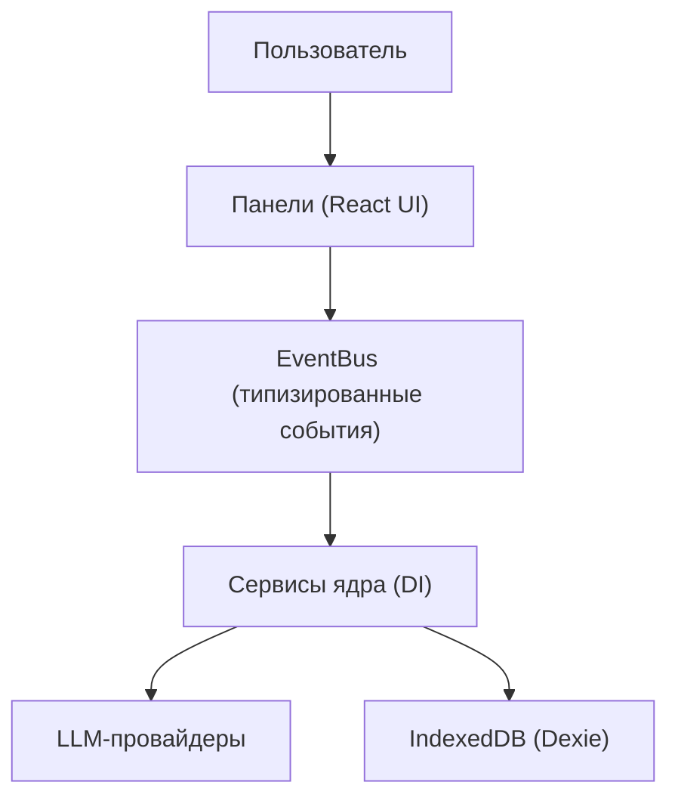

<!-- АВТОСГЕНЕРАЦИЯ: файл создан scripts/gen-wiki-docs.mjs из корпуса Wiki (src/components/WikiPanel). Не редактировать вручную. -->

# Что такое SuperAgents OS

> Раздел: **Руководство** · Статус: documented · Теги: обзор, философия, local-first

Источники: `README_EN.md`

## Что это

SuperAgents OS — браузерная операционная система для оркестрации распределённого интеллекта: несколько LLM-провайдеров, роли агентов, память и когнитивные конвейеры в одной среде. Все данные остаются на твоей машине (IndexedDB), сервера нет.

## Чем отличается от чат-бота

- Это не один чат, а [Возможности ОС](./capabilities.md): дебаты моделей, команды агентов, инструменты, память, диагностика.
- Общение идёт через типизированную шину событий, панели и сервисы развязаны.
- Маршрутизация выбирает провайдера (UCB1-бандит, broadcast, race), а не привязана к одной модели.

## С чего начать

См. [Как пользоваться панелями](./panels-guide.md): добавь ключ провайдера, проверь health, открой чат.

---

## Связанные материалы

- [Возможности ОС](./capabilities.md)
- [Архитектура и связи](./architecture.md)
- [Провайдеры и маршрутизация](./providers.md)

[← Все материалы](./README.md)
